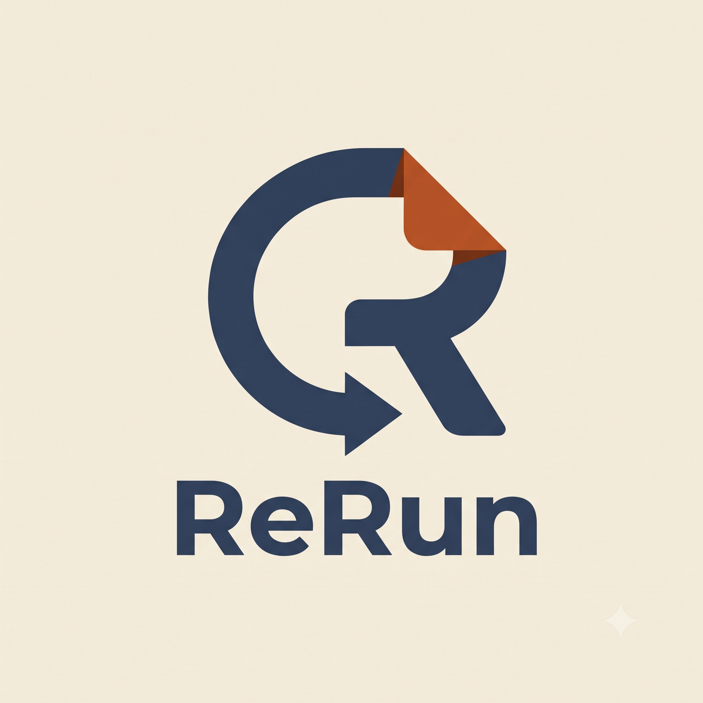
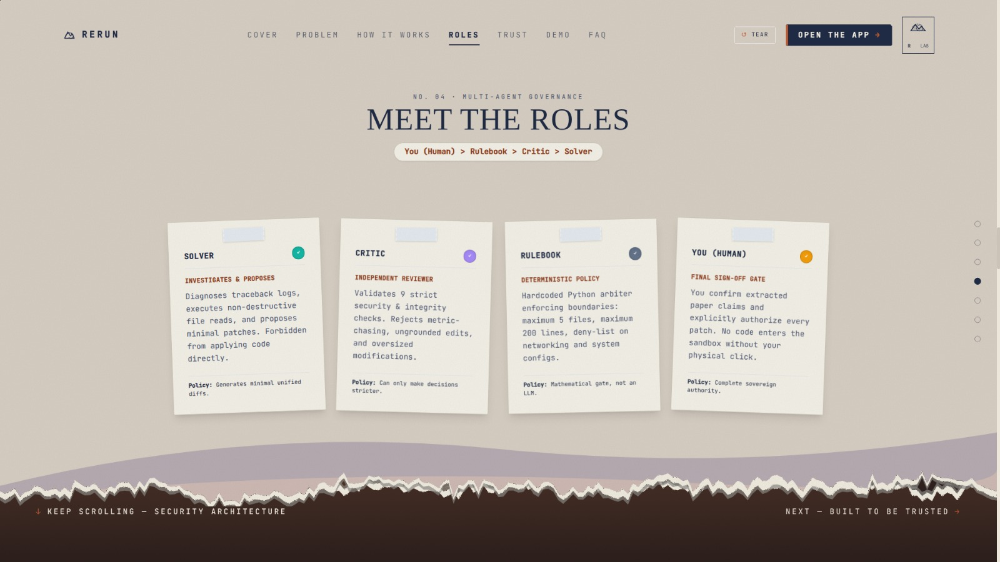
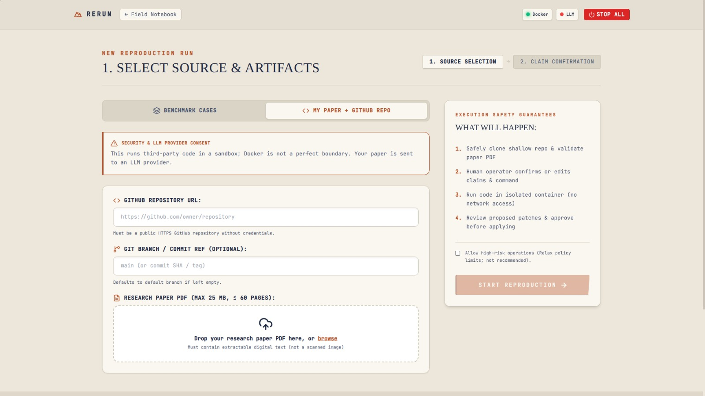
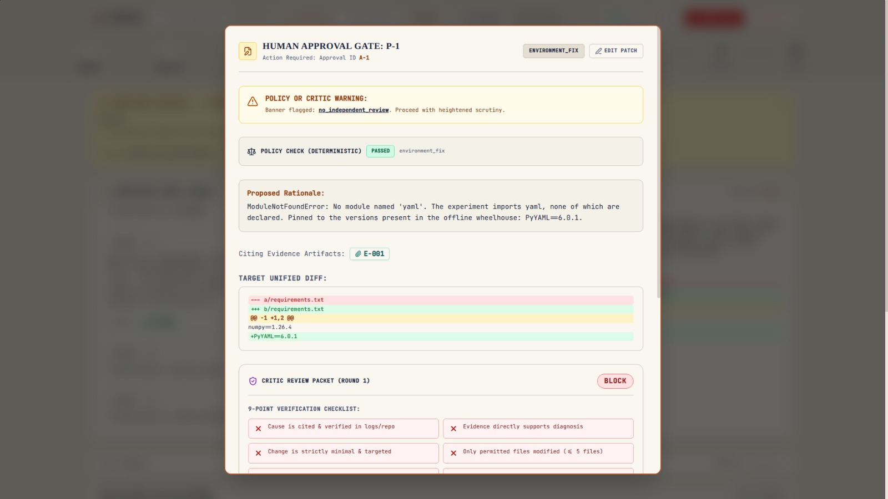
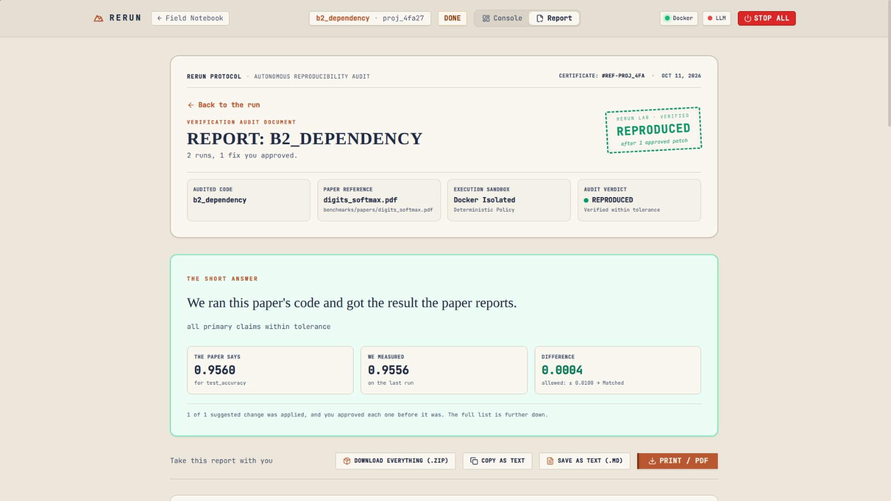
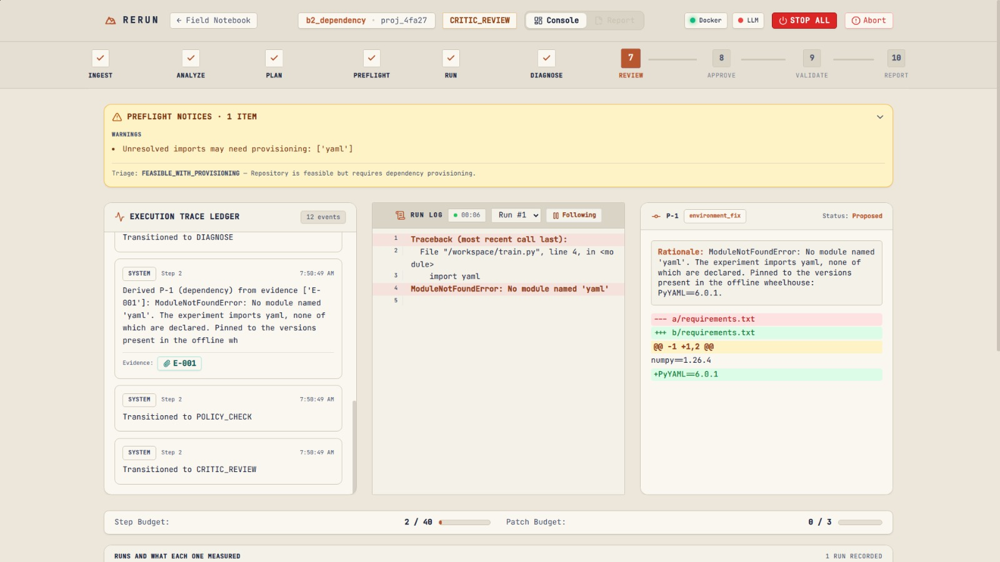
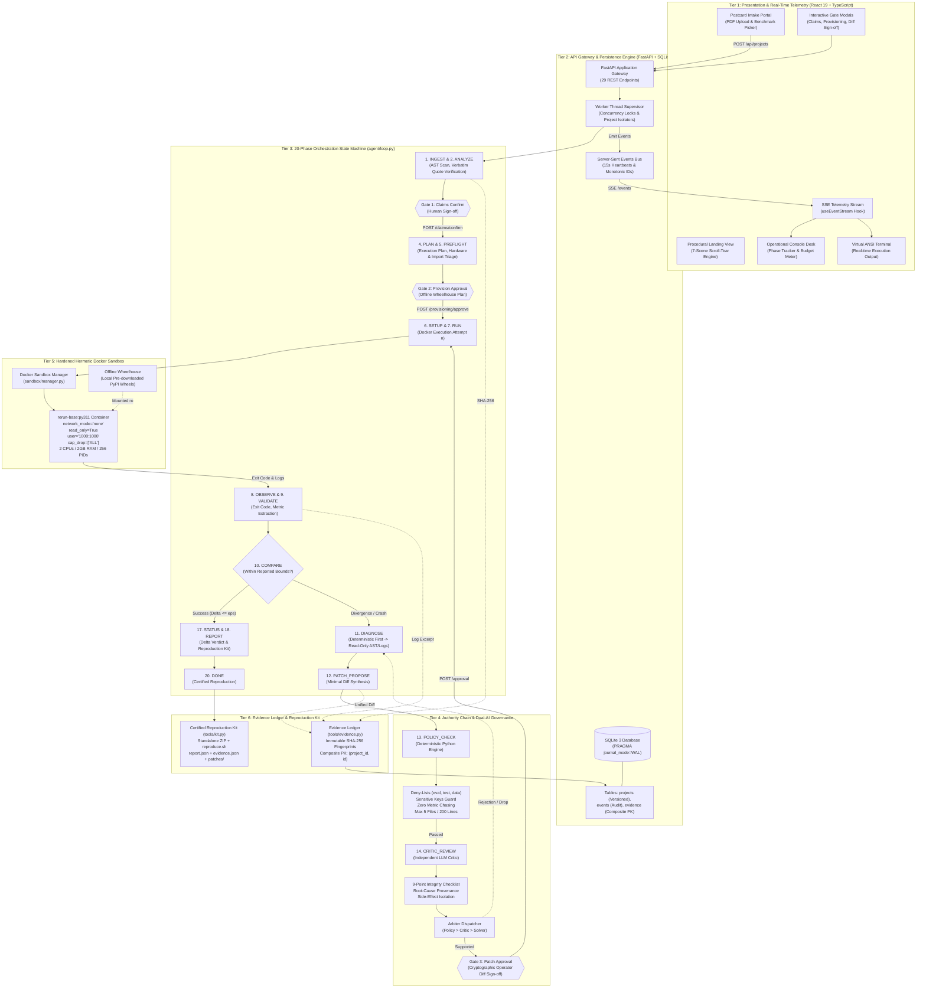

<div name="readme-top"></div>

<div align="center">
  
</div>

<div align="center">

# Rerun — Autonomous Research Paper Reproducibility Agent

[](https://python.org)
[](sandbox/)
[](backend/)
[](frontend/)
[](tests/)
[](benchmarks/MEASURED.md)

</div>

---

**Rerun** is an autonomous AI agent engineered to verify whether published machine learning research code faithfully reproduces stated headline results inside network-isolated Docker sandboxes. It investigates crashes, resolves missing dependencies and configuration drift, enforces strict multi-layered policy guardrails, and produces verifier-certified reproduction reports with tamper-evident cryptographic ledgers.

###  Key Insights & Capabilities
- **Automated Headline Claim Extraction** — Extracts target metrics, reported numbers, and tolerance bounds directly from paper PDFs.
- **Hermetic Sandbox Isolation** — Executes code inside hardened Docker containers with zero network access (`network_mode="none"`), non-root execution (`uid 1000`), and a read-only root filesystem.
- **Strict Authority Chain** — $\text{Human} > \text{Policy Engine (Code)} > \text{Critic (LLM)} > \text{Solver (LLM)}$. The AI cannot approve its own code patches or alter evaluation semantics.
- **Deterministic-First Diagnosis** — Common failures (missing packages, learning rate typos) are diagnosed via deterministic rules before invoking LLM solvers, eliminating stochastic flakiness.
- **Cryptographic Evidence Ledger** — Every claim, log slice, patch diff, and output artifact is assigned an immutable SHA-256 fingerprint.
- **Three Mandatory Human Gates** — Parks execution for operator sign-off at claim extraction, wheelhouse provisioning, and code patch application.
- **Self-Contained Reproduction Kits** — Exports standalone `.zip` kits containing the report, raw logs, and verified patch diffs for offline peer review.

---

##  Interface Tour

### 1. Interactive Narrative Landing Page
*Features a 7-scene procedural scroll-tear narrative engine exploring the scientific replication crisis and Rerun's authority model.*

<div align="center">
  
</div>

---

### 2. Multi-Layer Authority Chain & Roles
*Interactive authority hierarchy view establishing that human and deterministic policy strictly govern LLM solvers and critics.*

<div align="center">
  
</div>

---

### 3. Postcard Intake & Preflight Triage
*Intake portal supporting preset benchmark selections (`b1`–`b5`), custom public Git repositories, paper PDF parsing, and preflight feasibility checks.*

<div align="center">
  
</div>

---

### 4. Gate 3: Human Patch Approval & Policy Review
*Interactive operator modal requiring explicit sign-off for code diffs after passing the 10-point Policy check and independent Critic review.*

<div align="center">
  
</div>

---

### 5. Verifier-Certified Reproduction Report & Evidence Ledger
*Full reproduction verdict with claim delta comparisons, per-attempt breakdowns, SHA-256 evidence ledger, and downloadable reproduction kit.*

<div align="center">
  
</div>

---

### 6. Real-Time Operational Console & Live Telemetry
*3-column operational desk featuring real-time Server-Sent Events (SSE) telemetry, live ANSI container terminal logs, and phase step progression.*

<div align="center">
  
</div>

---

##  Features

- **20-Phase Orchestration Finite State Machine** — Governs the reproduction lifecycle from initial ingestion (`INGEST`) to certified completion (`DONE`), handling human gate pauses, container retries, and budget caps.

- **Zero Metric Chasing** — Patch proposals justifying modifications solely to increase test accuracy without citing paper provenance or error tracebacks are strictly refused by the Policy engine.

- **Reachable Import & Offline Wheelhouse Provisioning** — Analyzes repository AST imports, plans minimal missing wheels, and bundles them into an offline wheelhouse before isolated execution.

- **Dual-Model Solver & Critic Architecture** — The Solver proposes minimal code modifications; an independent Critic audits proposals against a 9-point integrity checklist before human escalation.

- **Hard Resource Ceilings** — Enforces strict limits: $\le 40$ orchestrator steps, $\le 3$ patch attempts, $\le 5$ modified files, $\le 200$ changed lines, 600s container timeout, 2 CPUs, and 2 GB RAM.

- **Live SSE Event Broadcasting** — Real-time telemetry streaming from the execution engine to the web console with automatic reconnects and 15-second heartbeat intervals.

- **Adversarial Red-Team Immune** — Formally verified against 9 adversarial attack fixtures (`x1`–`x9`) attempting deny-list tampering, data leakage, and unpinned dependencies.

---

##  Tech Stack

**Frontend**: React 19 · TypeScript · TailwindCSS · Vite · Recharts · Lucide Icons  
**Backend**: Python 3.12 · FastAPI · SQLite (WAL Mode) · Pydantic v2 · Uvicorn  
**Sandbox & Isolation**: Docker Engine (`rerun-base:py311`, `--network none`, `--cap-drop ALL`, non-root `uid 1000`)  
**LLM & Reasoning**: Google Gemini API · Deterministic Replay Engine (`LLM_MODE=replay` / `live`)  
**Build & Dev Tooling**: Node.js 20 · Python Venv · Makefile · GitHub Actions CI  

---

##  System Architecture & Engineering Blueprint

Rerun is architected as an air-gapped, multi-tiered autonomous verification system designed to eradicate the scientific replication crisis in machine learning. Its architecture enforces strict **defense-in-depth isolation**, separating untrusted code execution from reasoning, and subjecting every autonomous intervention to deterministic verification and human sign-off.

### Core Architectural Tenets
1. **Hermetic Execution Isolation** — Untrusted research code never touches the network or the host operating system. All execution occurs in strictly capped, read-only Docker containers.
2. **Dual-AI Separation of Concerns** — The **Solver LLM** proposes hypotheses and minimal diffs; the **Critic LLM** independently audits proposals against a 9-point integrity checklist. Neither LLM is permitted to self-approve modifications.
3. **Deterministic Governance Supremacy** — Hardcoded deterministic Python policy checks and AST verification supersede LLM reasoning at every juncture: $\text{Human} \succ \text{Policy Engine (Code)} \succ \text{Critic (LLM)} \succ \text{Solver (LLM)}$.
4. **Mandatory Human-in-the-Loop Gates** — The engine pauses execution for human authorization at three critical inflection points: claim verification, dependency provisioning, and patch application.
5. **Cryptographic Tamper-Evidence** — Every artifact, paper quote, log slice, and patch diff is recorded in an immutable append-only ledger fingerprinted with SHA-256 hashes.

---

### System Architecture Diagram



---

### Six-Tier Subsystem Breakdown

#### Tier 1: Presentation & Real-Time Telemetry Layer
- **Tech Stack**: React 19, TypeScript, Vite, Tailwind CSS, Lucide Icons, Recharts.
- **Narrative Engine (`Landing.tsx`)**: Procedural 7-scene scroll-tear engine (`useStatic`, `tear.ts`, Canvas physics) illustrating the scientific replication crisis and Rerun's authority hierarchy.
- **Postcard Intake Portal (`NewProject.tsx`)**: Dual-mode ingestion interface supporting instant preset selection (`b1`–`b5`), remote public Git cloning, PDF drag-and-drop ingestion, and automatic preflight feasibility triage.
- **Operational Console Desk (`Dashboard.tsx`)**: 3-column operator desk featuring:
  - `PhaseBar.tsx`: 20-phase timeline visualizing current execution step, active human gates, and terminal states.
  - `BudgetBar.tsx`: Real-time meter tracking step budget ($\le 40$), patch attempts ($\le 3$), and token consumption.
  - `TracePanel.tsx`: Live SSE feed grouping events by actor (`human`, `system`, `solver`, `critic`, `tool`).
  - `Terminal.tsx`: Virtual ANSI terminal emulator streaming container stdout/stderr with multi-attempt tabs.
  - Interactive Gate Modals: Modals for Gate 1 (Claims Confirmation), Gate 2 (Wheelhouse Provisioning), and Gate 3 (Unified Diff Sign-off).
- **Report & Certificate View (`Report.tsx`)**: Interactive reproduction report displaying target vs. observed deltas, per-attempt breakdowns, SHA-256 evidence tables, and one-click reproduction kit export.

#### Tier 2: API Gateway & Persistence Engine
- **Tech Stack**: FastAPI, Uvicorn, SQLite 3 (WAL Mode), Pydantic v2.
- **REST Surface**: 29 endpoints handling project creation, lifecycle management (start, stop, resume, abort), human gate responses, evidence queries, log streams, and artifact kits.
- **Real-Time Telemetry Bus (`sse.py`)**: Asynchronous Server-Sent Events (SSE) broker maintaining per-project broadcast channels with 15-second heartbeat keepalives and monotonic event sequence IDs.
- **Background Worker Supervisor (`runner.py`)**: Multi-threaded execution manager ensuring strict single-worker concurrency per project (`project_locks`), thread-safe state persistence, and clean cancellation via container kills.
- **Database Architecture (`db.py`)**:
  - `projects`: Primary project table with optimistic concurrency control (`version` column) and isolated error handling (`CorruptProjectStateError` surfaced as HTTP 422).
  - `events`: Append-only chronological audit log of all system and agent events.
  - `evidence`: Composite primary key `(project_id, id)` ensuring absolute evidence isolation across distinct runs.

#### Tier 3: 20-Phase Orchestration State Machine (`agent/loop.py`)
- Governed by an immutable finite state machine cycling through 20 discrete phases.
- Transitions are deterministic: every phase handler persists updated state to SQLite before handing off control.
- Hard resource boundaries terminate runaway runs: max 40 steps, max 3 patch cycles, 600s per container execution.

#### Tier 4: Multi-Level Authority Chain & Dual-AI Governance
- **Strict Authority Ordering**:
  $$\mathbf{Human\ Operator} \succ \mathbf{Deterministic\ Policy\ Engine} \succ \mathbf{Independent\ Critic\ (LLM)} \succ \mathbf{Solver\ (LLM)}$$
- **Deterministic Policy Engine (`tools/policy.py`)**:
  - Non-bypassable Python verification running *before* the Critic or Human sees any proposal.
  - Enforces `DENY_LIST`: Blocks modifications to evaluation metrics, test harnesses, data splits, and dataset files (`eval.*`, `metric.*`, `test_.*`, `split.*`, `data.*`).
  - Enforces `SENSITIVE_KEYS`: Locks seeds, epochs, train/test ratios, and batch sizes unless validated verbatim against paper quotes with numerical tolerance $\le 10^{-9}$.
  - Blocks **Metric Chasing**: Rejects patches claiming to "increase accuracy" or "fit the target" without a verified bug traceback or configuration mismatch.
  - Enforces file size limits: $\le 5$ modified files and $\le 200$ changed lines per patch.
- **Independent Critic (`agent/critic/review.py`)**:
  - LLM auditor operating under separate prompts and evaluation criteria.
  - Evaluates proposals against a 9-point integrity checklist (cause cited, minimal change, files in scope, provenance verified, evaluation untampered, reversibility, side-effects isolated).
- **Arbiter Dispatcher (`agent/arbiter.py`)**:
  - Policy violation &rarr; **DROP** immediately (Critic never invoked).
  - Critic `NEEDS_REVISION` &rarr; **REVISE** (routes back to Solver for up to 2 revision rounds).
  - Critic `SUPPORTED` or revisions exhausted &rarr; **TO_HUMAN** (escalates to Gate 3 with security warning banners).

#### Tier 5: Hardened Hermetic Docker Sandbox (`sandbox/manager.py`)
- **Base Image**: `rerun-base:py311` (Debian Bookworm slim).
- **Isolation Invariants**:
  - Zero network access: `network_mode = "none"` (no DNS, no outbound sockets).
  - Unprivileged execution: `user = "1000:1000"`, `cap_drop = ["ALL"]`, `security_opt = ["no-new-privileges"]`.
  - Read-only root filesystem: `read_only = True` with volatile RAM-backed `/tmp` (`tmpfs`, 256MB/1024MB).
  - Resource ceilings: 2 CPUs (`nano_cpus = 2 * 10^9`), 2GB RAM (`mem_limit = "2g"`, `memswap_limit = "2g"`), 256 maximum PIDs.
  - Offline wheelhouse mounting: Dependencies installed exclusively from local read-only host directories via `pip install --no-index --find-links /wheelhouse`.

#### Tier 6: Cryptographic Evidence Ledger & Reproduction Kit (`tools/evidence.py`, `kit.py`)
- **Immutable Ledger**: Every paper quotation, repository AST profile, container log excerpt, and patch diff is assigned a permanent identifier (`E-001`, `E-002`, ...) and SHA-256 checksum.
- **Standalone Reproduction Kit**: Upon run completion, exports a self-contained `.zip` package containing:
  - `report.json` and `report.html`: Verifier-certified reproduction verdict and delta breakdown.
  - `evidence.json`: Full SHA-256 evidence hash-chain.
  - `patches/`: Clean unified diff files for all applied fixes.
  - `logs/`: Complete stdout/stderr logs from all container attempts.
  - `reproduce.sh`: Offline bash script enabling one-click independent verification by external peer reviewers.

---

### The Three Mandatory Human-in-the-Loop Gates

Rerun intentionally refuses full end-to-end autonomy without human oversight. Three mandatory gates enforce operator authorization:

```
[ INGEST & ANALYZE ] ──> [ GATE 1: CLAIMS CONFIRM ] ──> Operator verifies headline claim & target metric
                                     ↓
[ PREFLIGHT AUDIT ]  ──> [ GATE 2: PROVISION APPROVE ] ──> Operator approves offline wheel download plan
                                     ↓
[ CRITIC AUDIT ]     ──> [ GATE 3: PATCH APPROVAL ] ──> Operator inspects unified diff & authorizes commit
```

1. **Gate 1: Claims Confirmation (`CLAIMS_CONFIRM`)**
   - **Purpose**: Prevents the agent from hallucinating or shifting the scientific goalpost.
   - **Operator Action**: Reviews candidate claims extracted from the paper PDF. The operator selects the primary claim, verifies the reported metric value ($0.956$), acceptable tolerance ($\pm 0.01$), and confirms or customizes the target execution command.
2. **Gate 2: Provisioning Approval (`PREFLIGHT`)**
   - **Purpose**: Prevents untrusted third-party dependencies from being injected into the air-gapped environment.
   - **Operator Action**: Reviews the list of missing Python packages identified during the AST import scan. The operator inspects package names, wheel sources, and base image specifications before authorizing wheel downloads.
3. **Gate 3: Patch Approval (`APPROVAL`)**
   - **Purpose**: Ensures no code modification is committed to the repository without human review.
   - **Operator Action**: Inspects the unified diff in an interactive side-by-side viewer. The modal displays the Policy Engine status badge, the Independent Critic review verdict, cited evidence links, and risk classification. If the Critic flagged concerns, a warning banner requires explicit two-step confirmation.

---

### Authority Decision Matrix

The **Arbiter** (`agent/arbiter.py`) enforces strict separation of authority, evaluating Policy Engine results and Critic reviews to determine patch disposition:

| Policy Engine Result | Independent Critic Verdict | Revision Round | Arbiter Action | State Transition & Banner |
|---|---|:---:|:---:|---|
| **FAIL** (Violation) | *Not Invoked* | Any | **`DROP`** | Discard patch &rarr; `DIAGNOSE` (Reason: policy violation) |
| **PASS** | `SUPPORTED` | Any | **`TO_HUMAN`** | Escalate to Gate 3 &rarr; `APPROVAL` (Clean diff) |
| **PASS** | `NEEDS_REVISION` | Round $1 < 2$ | **`REVISE`** | Return to Solver &rarr; `PATCH_PROPOSE` (Targeted feedback) |
| **PASS** | `NEEDS_REVISION` | Round $2 \ge 2$ | **`TO_HUMAN`** | Escalate to Gate 3 &rarr; `APPROVAL` (Banner: `critic_objects`) |
| **PASS** | `UNAVAILABLE` | Any | **`TO_HUMAN`** | Escalate to Gate 3 &rarr; `APPROVAL` (Banner: `no_independent_review`) |

---

### Data & Artifact Flow Lifecycle

$$\text{Paper PDF + Git Repo} \xrightarrow[\text{SHA-256}]{\text{Ingest}} \mathbf{Gate\ 1} \xrightarrow[\text{AST Triage}]{\text{Provision}} \mathbf{Gate\ 2} \xrightarrow[\text{Hermetic Run}]{\text{Docker}} \mathbf{Gate\ 3} \xrightarrow[\text{Policy / Critic}]{\text{Diff Sign-off}} \mathbf{Certified\ Reproduction\ Kit}$$

Every stage of the reproduction lifecycle is bound to the immutable cryptographic evidence ledger:

1. **Intake & Paper Parsing**: Paper PDF is validated for valid magic bytes (`%PDF-1.`), text streams are extracted, and verbatim quotes are matched with fuzzy substring alignment.
2. **Deterministic Preflight**: Repository AST is traversed to map imports against standard library and installed wheels. Missing dependencies generate an offline wheelhouse manifest.
3. **Containerized Execution**: Code runs under `rerun-base:py311` with strict timeout supervision. Standard output, error streams, and created artifacts are mirrored to host logs.
4. **Metric Verification**: Reported values ($v_r$) and observed values ($v_o$) are evaluated via numerical tolerance bounds:
   $$|v_o - v_r| \le \epsilon$$
5. **Certification & Ledger Serialization**: All evidence items are signed with SHA-256 digests and packaged into a standalone reproduction kit ZIP containing `report.json`, `evidence.json`, and an offline `reproduce.sh` script.

---

##  Empirical Evaluation (Track A Benchmark Sweep)

Measured under real Docker execution (`DockerSandbox`, base image `rerun-base:py311`, offline network) across two consecutive validation sweeps:

| Benchmark Case | Description | Target Metric | Gold Expected | B-0 (No Agent) | B-2 (One-Shot) | Rerun (Autonomous) | Outcome |
|---|---|:---:|:---:|:---:|:---:|:---:|---|
| `b1_control` | Clean digits softmax baseline | `0.956 ± 0.01` | `REPRODUCED` | 1/1 | 1/1 | **1/1** | `REPRODUCED` (0 patches, acc: `0.9556`) |
| `b2_dependency` | Missing PyYAML package | `0.956 ± 0.01` | `REPRODUCED` | 0/1 | 1/1 | **1/1** | `REPRODUCED` (1 patch: `PyYAML==6.0.1`) |
| `b3_silent_config` | Divergent learning rate (`0.01` vs `0.5`) | `0.956 ± 0.01` | `REPRODUCED` | 0/1 | 1/1 | **1/1** | `REPRODUCED` (1 patch: `lr = 0.5`) |
| `b4_combined` | Missing PyYAML + Divergent LR | `0.956 ± 0.01` | `REPRODUCED` | 0/1 | 0/1 | **1/1** | `REPRODUCED` (2 patches applied) |
| `b5_unable` | Mandatory CUDA GPU requirement | CUDA VRAM | `UNABLE_TO_EXECUTE` | 1/1 | 1/1 | **1/1** | `UNABLE_TO_EXECUTE` (Honest triage) |

### Sweep Success Summary
- **B-0 Baseline (No Agent)**: 2/5 runs matched gold (40.0%)
- **B-2 Baseline (One-Shot LLM)**: 4/5 runs matched gold (80.0%)
- **Rerun (Autonomous Agent)**: **5/5 runs matched gold (100.0%)** on both sweeps

---

## ⚡ Quick Start

### 1. Installation & Setup

```bash
# 1. Clone repository and navigate to root
git clone https://github.com/your-username/rerun.git
cd rerun

# 2. Set up Python virtual environment
python3 -m venv .venv && source .venv/bin/activate
pip install -r requirements-dev.txt

# 3. Configure environment template
cp .env.example .env
# (Optional: Add SOLVER_API_KEY for live queries; replay mode works out of the box)

# 4. Build hardened base Docker image
make images

# 5. Populate offline wheelhouse
make wheelhouse

# 6. Install frontend dependencies
npm install --prefix frontend
```

### 2. Launching the System

```bash
# Terminal 1: Start FastAPI Backend (Port 8000)
make api

# Terminal 2: Start Vite Frontend (Port 5173)
make ui
```

Open [http://localhost:5173](http://localhost:5173) to access the interactive console.

### 3. Running Benchmarks & Tests

```bash
# Run full Pytest suite (319 tests)
make test

# Run Track A benchmark evaluation sweep
make bench

# Run red-team adversarial suite (9/9 refused)
python3 scripts/dev.py adversarial

# Run hardened sandbox smoke test
python3 scripts/dev.py hardened-smoke
```

---

##  CLI & Operational Tooling (`scripts/dev.py`)

`scripts/dev.py` provides commands for developers and operators:

| Command | Description |
|---|---|
| `python3 scripts/dev.py setup` | Installs dev dependencies and verifies runtime environment |
| `python3 scripts/dev.py images` | Builds `rerun-base:py311` hardened sandbox Docker image |
| `python3 scripts/dev.py hardened-smoke` | Verifies container security invariants against real Docker daemon |
| `python3 scripts/dev.py wheelhouse` | Pre-downloads offline wheels for network-isolated dependencies |
| `python3 scripts/dev.py bench` | Executes the 5 Track A benchmark cases across baselines and Rerun |
| `python3 scripts/dev.py adversarial` | Feeds all 9 adversarial fixtures (`x1`–`x9`) through policy & critic gates |
| `python3 scripts/dev.py prune` | Reclaims disk space from finished runs while preserving evidence |
| `python3 scripts/dev.py cleanup` | Kills orphan containers and cleans dangling Docker volumes |
| `python3 scripts/dev.py build-benchmarks`| Generates synthetic datasets, seeded faults, and paper PDFs |

---

##  Security Model & Invariants

Rerun enforces 8 core invariants at the engine and container layers:

| Invariant | Name | Description |
|:---:|---|---|
| **I1** | **Deterministic Ingest** | Paper PDFs and code repositories are fingerprinted via SHA-256 before processing. |
| **I2** | **Immutable Ledger** | Evidence records in SQLite and `evidence.json` are append-only. |
| **I3** | **Network Isolation** | Container runs with `network_mode="none"`. Zero inbound/outbound connectivity. |
| **I4** | **Non-Root Execution** | Container executes under `uid=1000, gid=1000`. No root privileges. |
| **I5** | **Read-Only Root FS** | Root filesystem is mounted read-only; writes restricted to `/workspace` and tmpfs `/tmp`. |
| **I6** | **Dropped Capabilities** | All Linux capabilities dropped (`cap_drop=ALL`, `no-new-privileges`). |
| **I7** | **Strict Resource Quotas**| Hard caps: 2 CPUs, 2GB memory, 256 PIDs, 1GB tmpfs, 600s timeout. |
| **I8** | **Mandatory Human Sign-off** | Patches cannot be committed to disk without explicit human gate approval. |

---

##  Acknowledgments

- **Google DeepMind & Open-Source Research Community** — For continuous advocacy of empirical AI reproducibility.
- **Docker & Linux Container Ecosystem** — For providing hermetic containment primitives.
- **FastAPI, React & Vite Communities** — For responsive developer tooling and web frameworks.

<p align="center">
  <sub>Built for verifiable, transparent, and reproducible scientific computing.</sub>
</p>
